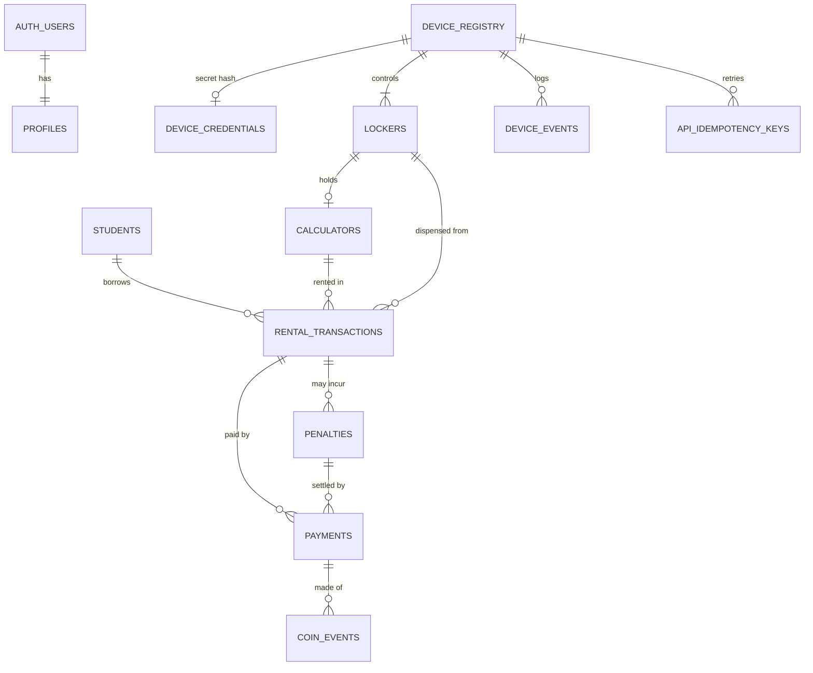

# Database Design

Supabase PostgreSQL 17 is the **source of truth**. SQLite on the Raspberry Pi is only an offline cache and queue (see [architecture.md](architecture.md)).

- Migrations: [`supabase/migrations/`](../supabase/migrations). Applied in filename order and **never edited after being pushed**.
- Development seed: [`supabase/seed.sql`](../supabase/seed.sql). All fake data.
- Tests: [`supabase/tests/schema.test.ts`](../supabase/tests/schema.test.ts). These run the real migrations in PGlite (`npm run test:db`).

## 1. Entity-relationship diagram



`system_settings` (a single row) and `audit_logs` (append-only, intentionally without foreign keys) stand alone.

## 2. Tables

| Table | Purpose | Key constraints |
|---|---|---|
| `profiles` | Dashboard users, 1:1 with `auth.users` | Role `SUPER_ADMIN` / `OFFICER` / `VIEWER`. New users start **inactive**. |
| `device_registry` | Each Raspberry Pi kiosk | `device_code` unique (`DEVICE-CALC-KIOSK-001`) |
| `device_credentials` | SHA-256 hash of each kiosk's secret | Server-only: no dashboard user can read it |
| `lockers` | Physical compartments | `(device_id, locker_number)` and `(device_id, hardware_channel)` unique. Add Locker 3+ by inserting a row. |
| `calculators` | Inventory | `code` unique, `rfid_uid` unique (Rule 5), `locker_id` unique (Rule 6) |
| `students` | Created on first QR scan | `student_number` unique. A `BLOCKED` student needs a reason. |
| `system_settings` | Business rules | Exactly one row. Every value is range-checked. |
| `rental_transactions` | One row per rental, never overwritten | See §3 |
| `payments` | Rental and penalty payments | One live rental payment per rental (Rule 3) |
| `penalties` | Overdue/damage charges, separate from the fee | `amount_due` is computed by the database; it can't be over-cleared |
| `coin_events` | Every coin pulse group from the selector | ID generated on the Pi, so retries are harmless |
| `device_events` | Hardware event log for debugging | Indexed for "latest errors" |
| `audit_logs` | Admin and system actions | Append-only (no UPDATE, no DELETE) |
| `api_idempotency_keys` | Cached responses to device requests | Primary key `(device_id, idempotency_key)` |

## 3. How the design rules are enforced *by the database*

| Rule | Enforcement |
|---|---|
| 1. One active rental per student | Partial unique index `rentals_one_open_per_student` over the open statuses |
| 2. One active rental per calculator | Partial unique index `rentals_one_open_per_calculator` (also `..._per_locker`) |
| Race for the last calculator | The second simultaneous `INSERT` fails on the unique index, so only one student wins |
| 3. A payment is applied only once | Partial unique index `payments_one_live_rental_payment` |
| No payment bypass | Check `rentals_paid_in_full`: nothing beyond `PAID` unless `amount_paid >= rental_fee` |
| 5. Permanent RFID identity | `calculators.rfid_uid` unique, canonical format `04-A1-B2-C3-D4` |
| 7. Not ACTIVE until removal | Check `rentals_active_requires_removal` (needs `rental_rfid_verified`) |
| 8. Not COMPLETED until RFID verified | Check `rentals_completed_requires_return_verification` |
| 12. History never deleted | `BEFORE DELETE` triggers on rentals, payments, penalties, coin events and the audit log. These block even the service-role key. |
| 13. Audit trail | `audit_logs` is append-only |
| 15. Don't trust the frontend | Dashboard users have **SELECT only**. All writes go through the API (service role) after validation. |

Open statuses (listed in `OPEN_RENTAL_STATUSES`): `PENDING, PAYMENT_PENDING, PAID, DISPENSING, ACTIVE, OVERDUE, RETURNING`.

## 4. Status model

Three status columns exist on purpose, and each one answers a different question:

| Column | Question it answers |
|---|---|
| `rental_transactions.status` | Where is *this transaction* in its lifecycle? |
| `calculators.status` | Can *this asset* be used? (`AVAILABLE`, `RENTED`, `MAINTENANCE`, `MISSING`, `DISABLED`) |
| `lockers.status` + `lock_state` / `door_state` / `rfid_state` | What is the *slot* doing, and what do its sensors physically see? |

"Overdue" lives **only** on the rental. A calculator out with an overdue student is simply `RENTED`, which avoids two places disagreeing about whether something is overdue.

Rental lifecycle:

```
PENDING → PAYMENT_PENDING → PAID → DISPENSING → ACTIVE → (OVERDUE) → RETURNING → COMPLETED
     ↘──────────────↘──────────↘─────────↘ CANCELLED / FAILED
```

## 5. Views

| View | What it adds |
|---|---|
| `v_rentals` | `effective_status`, which becomes **OVERDUE** the moment `now() > due_at` with no job needed. Also live overdue minutes, student, calculator and locker labels, and penalty balance. |
| `v_lockers` | The expected RFID UID, plus **`is_assignable`**, which is only true when the database *and* the RFID reader agree the calculator is inside, the lock is closed and the kiosk is online. Also `has_inventory_mismatch`. |
| `v_device_status` | `ONLINE` / `OFFLINE` (no heartbeat for 90 s) / `DISABLED` / `NEVER_SEEN` |

All views use `security_invoker = true`, so Row Level Security still applies.

## 6. Security (Row Level Security)

| Who | Can do |
|---|---|
| `anon` (the public key, no login): students and the public | **Nothing.** Privileges are revoked and there are no policies. |
| Logged in without an active profile | Sees zero rows |
| Active `VIEWER` / `OFFICER` / `SUPER_ADMIN` | **Read** operational tables and views. Only `OFFICER`+ can read the audit log. |
| Server API (`service_role`) | Writes, after its own Zod validation and role or device checks |

Role helpers: `public.is_admin()`, `public.is_officer()`, `public.is_super_admin()`. To add a role, add it to the `admin_role` enum and the shared `AdminRole`, then update these helpers.

## 7. Conventions

- Timestamps are `timestamptz`, stored in UTC and shown in Asia/Manila time.
- Money is `numeric(10,2)`. The rental fee is a whole peso amount because only coins are accepted.
- RFID UIDs are uppercase hex bytes joined by dashes. Use `normalizeRfidUid()` from `@calc-rental/shared`.
- Every enum mirrors `packages/shared/src/enums.ts`. A test fails if they drift apart.
- Never edit a pushed migration. Add a new file named `supabase/migrations/<timestamp>_<name>.sql`.

## 8. Backups

The Supabase Free plan has **no downloadable automatic backups**. Before demos, and after important data changes, take a manual dump:

```bash
npx supabase db dump --remote --data-only -f backups/data-YYYYMMDD.sql
```

`backups/` is git-ignored because it contains student data. Paid plans add daily backups and point-in-time recovery.
